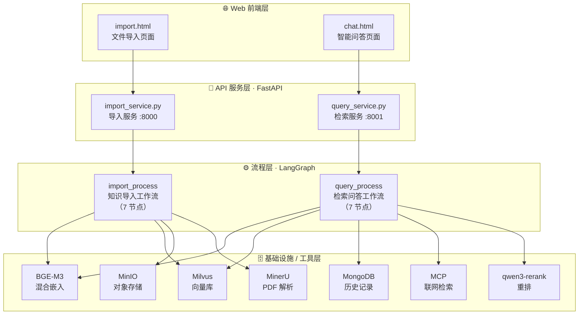
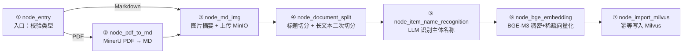
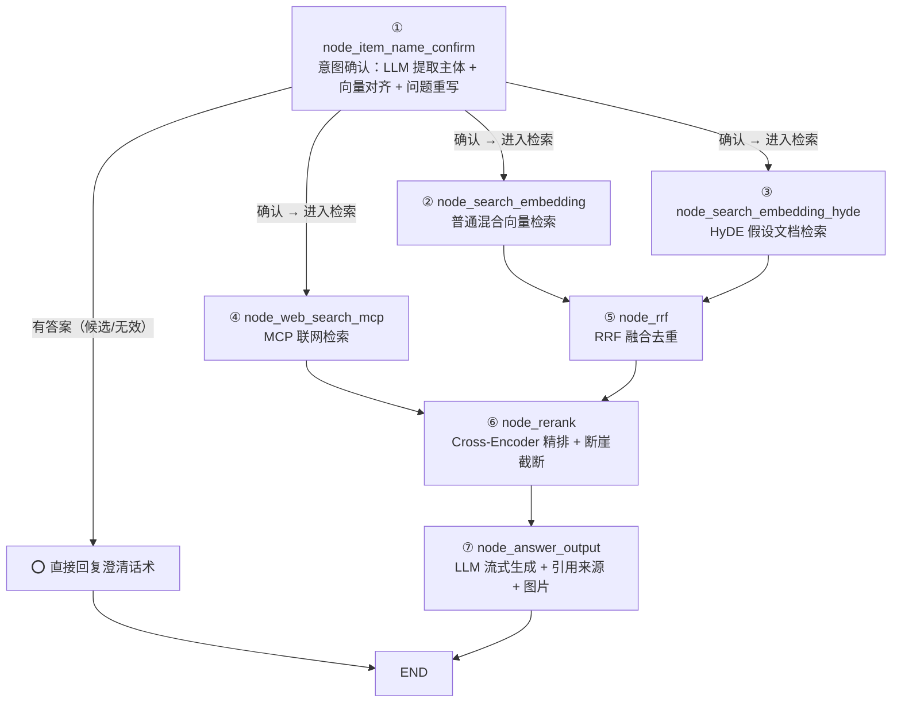
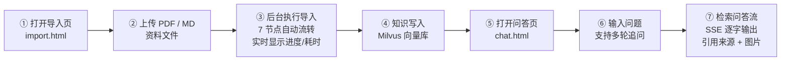

# 🏪 掌柜智库 — 生产级 RAG 知识库问答系统

> 基于 
>
> **LangGraph + Milvus + BGE-M3 + DashScope**
>
>  构建的检索增强生成（RAG）全流程实战项目，源自
>
> **尚硅谷《大模型技术之 LLM》系列课程・掌柜智库项目**
>
> （14 天实战），覆盖 
>
> **知识导入（Ingestion）**
>
>  与 
>
> **智能问答（Retrieval & Generation）**
>
>  两条完整流水线。


***

## 📖 目录


1. [项目简介](#1-项目简介)

2. [功能特性](#2-功能特性)

3. [技术栈](#3-技术栈)

4. [系统架构](#4-系统架构)

5. [目录结构](#5-目录结构)

6. [快速开始](#6-快速开始)

7. [使用流程](#7-使用流程)

8. [API 接口](#8-api-接口)

9. [核心模块详解](#9-核心模块详解)

10. [项目亮点](#10-项目亮点)

11. [常见问题](#11-常见问题)

12. [参考与致谢](#12-参考与致谢)


***

## 1. 项目简介

**掌柜智库** 是一个面向**多领域知识库**的 RAG（Retrieval-Augmented Generation）智能问答系统。用户上传 PDF / Markdown 资料后，系统自动完成「解析 → 图片处理 → 切分 → 主体识别 → 向量化 → 入库」全流程；问答时通过「意图确认 → 多路召回（向量检索 + HyDE + 联网搜索）→ RRF 融合 → Cross-Encoder 重排 → 流式生成」输出**带引用来源与图片**的精准答案。

项目支持**两类知识库场景**，通过 `.env` 配置一键切换：


| 场景            | 知识库内容                                   | 典型示例                           |
| ------------- | --------------------------------------- | ------------------------------ |
| **旅游知识库**（默认） | 景点介绍 / 线路推荐 / 酒店信息 / 美食推荐 / 交通指南 / 文化民俗 | 成都、三亚、张家界等目的地资料                |
| **商品知识库**     | 产品手册 / 说明书 / 安全规范                       | Brother HAK180 烫金机、RS-12 数字万用表 |

> 架构天然支持扩展至教育、听书、育儿等更多垂直领域（只需调整 Prompt 模板 + Milvus 集合名 + 元数据字段即可完成迁移）。


***

## 2. 功能特性

### 📥 知识导入流水线


* **PDF → Markdown 解析**：MinerU API 自动解析 PDF，含批量上传、轮询下载、ZIP 解压

* **图片智能处理**：视觉大模型（qwen3-vl-flash）生成图片摘要 + MinIO 托管替换 URL；滑动窗口令牌桶限流保护 API 配额

* **智能文档切分**：按 Markdown 标题层级切分（含代码块识别）+ 长文本二次递归切分（overlap 机制）

* **主体名称自动识别**：LLM 提取文档核心主题（目的地 / 商品），向量化写入 Milvus 主体集合

* **BGE-M3 混合向量化**：同时产出稠密（dense）+ 稀疏（sparse）向量，批量处理

* **幂等写入 Milvus**：自动建集合、建索引、去重写入，支持加载轮询（规避 `collection not loaded`）

### 🔍 检索问答流水线


* **多轮意图理解**：LLM 从历史会话提取主体名称（含指代消解）+ 内容类型分类 + 问题重写

* **三级主体对齐**：向量检索评分 → `≥0.85` 确认 / `≥0.6` 候选 / 其余无效 → 分流处理

* **三路并行召回**：普通向量检索 × HyDE 假设文档检索 × MCP 联网检索（LangGraph 自动并发）

* **RRF 倒数排名融合**：跨路去重 + 分数累加，天然支持横向扩展新召回源

* **两阶段精排**：BGE-M3 双编码粗排 → qwen3-rerank Cross-Encoder 精排 → **断崖检测**动态截断（过滤低相关噪声）

* **流式 SSE 答案生成**：逐字输出 + 引用来源 + 图片附件，实时展示节点执行进度与耗时

### 🛠️ 工程化能力


* **实时可观测**：节点级状态上报与耗时统计，SSE 推送，`task_error` 事件精准透传异常

* **历史会话管理**：MongoDB 按 `session_id` 持久化多轮对话，支持回显、清空、续聊

* **全链路日志**：彩色日志（colorlog），每个节点独立日志输出

* **生产级细节处理**：UTF-8 字节安全截断、Milvus 集合幂等加载轮询、MinIO 幂等清理、滑动窗口限流、`end` 哨兵防 SSE 悬挂


***

## 3. 技术栈


| 分类           | 技术选型                                                                    |
| ------------ | ----------------------------------------------------------------------- |
| **语言 / 包管理** | Python ≥ 3.12 · uv（pyproject.toml + uv.lock）                            |
| **工作流编排**    | LangGraph（StateGraph 有向图 + 条件路由 + 并行分支）                                 |
| **LLM 调用**   | LangChain `init_chat_model`・阿里云百炼 DashScope（qwen-flash /qwen3-vl-flash） |
| **嵌入模型**     | BGE-M3（FlagEmbedding，1024 维稠密 + 稀疏向量）                                   |
| **向量数据库**    | Milvus 2.x（Hybrid Search + WeightedRanker 加权融合）                         |
| **重排序**      | DashScope qwen3-rerank（Cross-Encoder + 断崖检测）                            |
| **对象存储**     | MinIO（PDF 备份 / 图片托管，公开读 / 认证写）                                          |
| **文档数据库**    | MongoDB（PyMongo，会话历史增删改查）                                               |
| **Web 服务**   | FastAPI · Uvicorn · SSE（Server-Sent Events） · CORS                      |
| **PDF 解析**   | MinerU（Markdown 转换 API）                                                 |
| **联网检索**     | OpenAI Agents SDK・MCP 协议・百炼 WebSearch                                   |
| **深度学习**     | PyTorch（GPU/CPU）、Transformers                                           |


***

## 4. 系统架构

### 4.1 总体分层架构

项目遵循「**Web 前端层 → API 服务层 → LangGraph 流程层 → 基础设施工具层**」四层架构：




### 4.2 知识导入工作流（import\_process）

7 节点串联，按文件类型条件路由：




### 4.3 检索问答工作流（query\_process）

7 节点，含并行分支 + 条件路由：





***

## 5. 目录结构


```
RAG/
├── atguigu/                          # 项目主代码包
│   ├── config/
│   │   └── config.py                 # 配置类：加载 .env（LLM/Milvus/MinIO/MongoDB/MCP/Reranker/BGE）
│   ├── import_process/               # 📥 知识导入工作流（LangGraph）
│   │   ├── base.py                   # 节点基类（状态上报 + 耗时统计）
│   │   ├── state.py                  # 导入 State（TypedDict：路径/内容/元数据/向量）
│   │   ├── main_graph.py             # 主图：入口路由 + 7 节点串联
│   │   └── nodes/                    # 入口 / PDF转MD / 图片处理 / 文档切分 / 主体识别 / 向量化 / 导入Milvus
│   ├── query_process/                # 🔍 检索问答工作流（LangGraph）
│   │   ├── base.py
│   │   ├── state.py                  # 查询 State（TypedDict：意图/检索/排序/答案）
│   │   ├── main_graph.py             # 主图：意图确认 → 三路并行 → RRF → Rerank → 生成
│   │   └── nodes/                    # 意图确认 / 混合检索 / HyDE检索 / MCP检索 / RRF / Rerank / 答案输出
│   ├── tool/                         # 🛠️ 基础设施工具层
│   │   ├── bgem3_client_tool.py      # BGE-M3 嵌入（全局单例，稠密 + 稀疏）
│   │   ├── milvus_client_tool.py     # Milvus 客户端（Hybrid Search / 加载轮询 / UTF-8 截断）
│   │   ├── minio_client_tool.py      # MinIO 客户端（桶策略 / 幂等清理 / 上传）
│   │   ├── mongodb.py                # MongoDB 会话历史（增删改查）
│   │   ├── reranker_tool.py          # qwen3-rerank 重排封装
│   │   ├── task_utils.py             # 任务状态 / 节点进度 / 耗时 / SSE 队列
│   │   ├── prompt.py                 # 全部 Prompt 模板
│   │   ├── logger.py                 # 彩色日志（colorlog）
│   │   └── json_format_tool.py       # JSON 格式化工具
│   ├── web/                          # 🌐 Web 层
│   │   ├── api/
│   │   │   ├── import_service.py     # 导入 API 服务（FastAPI，:8000）
│   │   │   └── query_service.py      # 检索 API 服务（FastAPI，:8001，SSE）
│   │   └── page/
│   │       ├── import.html           # 文件导入前端页面
│   │       └── chat.html             # 智能问答前端页面
│   └── test/                         # 测试脚本 / FastAPI 学习示例
├── pyproject.toml                    # 项目定义（uv 依赖管理）
├── uv.lock                           # 锁定依赖版本
├── .env.example                      # 环境变量模板（⚠️ 请复制为 .env 并填入真实密钥）
└── .gitignore
```


***

## 6. 快速开始

### 6.1 环境要求


| 组件          | 要求                | 说明                                         |
| ----------- | ----------------- | ------------------------------------------ |
| **Python**  | ≥ 3.12            | 推荐 uv 管理的 `.venv` 虚拟环境                     |
| **uv**      | 最新版               | Python 包管理与虚拟环境工具（`uv --version` 验证）       |
| **Milvus**  | 2.x（Standalone）   | 向量数据库，默认端口 `19530`，推荐 Docker 部署            |
| **MinIO**   | 最新版               | 对象存储，API `9000` / 控制台 `9001`               |
| **MongoDB** | 最新版               | 会话历史库，默认端口 `27017`                         |
| **阿里云百炼**   | DashScope API Key | qwen 系列 LLM + qwen3-rerank + WebSearch MCP |
| **MinerU**  | API Token         | PDF → Markdown 解析服务                        |
| **GPU（可选）** | CUDA              | BGE-M3 支持 GPU/CPU，GPU 建议开启 FP16            |

> 💡 中间件（Milvus / MinIO / MongoDB）按尚硅谷教程在 
>
> **CentOS 7 虚拟机**
>
> 中通过 Docker 部署，也可部署于任意可达主机。

### 6.2 环境搭建（从头开始）

#### 步骤一：安装中间件

参考以下文档在 CentOS 虚拟机或本机通过 Docker 部署中间件：


```
# 1. 安装 Docker & Docker Compose
# 2. 部署 Milvus
cd /opt
# 下载 milvus docker-compose.yml
docker compose up -d

# 3. 部署 MinIO
docker run -d --name minio \
  -p 9000:9000 -p 9001:9001 \
  -e MINIO_ROOT_USER=admin \
  -e MINIO_ROOT_PASSWORD=password \
  minio/minio server /data --console-address ":9001"

# 4. 部署 MongoDB
docker run -d --name mongodb -p 27017:27017 mongo:latest

# 验证所有服务正常运行
docker ps
```

#### 步骤二：安装依赖


```
# 进入项目根目录
cd RAG

# 使用 uv 同步虚拟环境（自动创建 .venv 并安装全部依赖）
uv sync

# 验证解释器指向 .venv\Scripts\python.exe
uv tree
```

#### 步骤三：配置环境变量


```
# 复制模板并填入真实密钥/服务地址
cp .env.example .env
```

`.env` 核心配置项：


| 变量                                       | 说明                                           |
| ---------------------------------------- | -------------------------------------------- |
| `MINERU_TOKEN`                           | MinerU PDF 解析 Token                          |
| `OPENAI_API_KEY`                         | 百炼 API Key（需具备 DashScope 权限）                 |
| `OPENAI_BASE_URL`                        | 百炼兼容 OpenAI 格式的 Base URL                     |
| `LLM_DEFAULT_MODEL`                      | 默认 LLM 模型（如 `qwen-flash`）                    |
| `VL_MODEL`                               | 视觉模型（如 `qwen3-vl-flash`）                     |
| `ITEM_MODEL`                             | 主体识别模型                                       |
| `MINIO_ENDPOINT`                         | MinIO 服务地址（如 `192.168.100.88:9000`）          |
| `MINIO_ACCESS_KEY` / `MINIO_SECRET_KEY`  | MinIO 访问凭证                                   |
| `MINIO_BUCKET_NAME`                      | MinIO 存储桶名称                                  |
| `MILVUS_URL`                             | Milvus 服务地址（如 `http://192.168.100.88:19530`） |
| `CHUNKS_COLLECTION`                      | 默认知识库切片集合名                                   |
| `ITEM_NAME_COLLECTION`                   | 默认主体名称集合名                                    |
| `TRAVEL_CHUNKS_COLLECTION`               | 旅游知识库切片集合名                                   |
| `TRAVEL_ITEM_NAME_COLLECTION`            | 旅游知识库主体集合名                                   |
| `USE_TRAVEL_COLLECTION`                  | 是否启用旅游集合（`true`/`false`）                     |
| `MONGO_URL` / `MONGO_DB_NAME`            | MongoDB 连接地址与库名                              |
| `MCP_API_KEY` / `MCP_DASHSCOPE_BASE_URL` | 百炼 WebSearch MCP 鉴权                          |
| `RERANK_BASE_URL` / `RERANK_API_KEY`     | qwen3-rerank 重排服务                            |
| `BGE_M3_PATH`                            | BGE-M3 本地模型路径                                |
| `BGE_DEVICE`                             | 运行设备（`cuda:0` 或 `cpu`）                       |
| `BGE_FP16`                               | 半精度开关（仅 GPU 有效，CPU 强制关闭）                     |

> ⚠️ 
>
> **重要：**
>
> `.env`
>
> **&#x20;已在&#x20;**
>
> `.gitignore`
>
> **&#x20;中忽略，切勿将真实密钥提交到 Git！**

#### 步骤四：下载 BGE-M3 嵌入模型


```
# 运行模型下载脚本（通过 ModelScope）
# 下载完成后将 BGE_M3_PATH 指向模型实际目录
```

### 6.3 启动服务

确认 Milvus / MinIO / MongoDB 均已可访问后，分别启动两个 API 服务：


```
# ============================================
# 终端 1：启动知识导入服务（端口 8000）
# ============================================
python -m atguigu.web.api.import_service

# ============================================
# 终端 2：启动检索问答服务（端口 8001）
# ============================================
python -m atguigu.web.api.query_service
```

> 💡 
>
> **启动后验证**
>
> ：
> 导入服务健康检查：
>
> `curl http://127.0.0.1:8000/docs`
>
> （FastAPI 自动生成 Swagger 文档）
> 检索服务健康检查：
>
> `curl http://127.0.0.1:8001/health`
> 前端问答页可直接浏览器打开 
>
> `atguigu/web/page/chat.html`

### 6.4 前端访问


```
📥 文件导入页：atguigu/web/page/import.html   → 浏览器直接打开
💬 智能问答页：atguigu/web/page/chat.html     → 浏览器直接打开（页面默认请求 http://127.0.0.1:8001）
```


***

## 7. 使用流程




**详细步骤：**


1. **导入知识**：打开 `import.html`，上传 PDF（产品手册 / 旅游攻略）或 Markdown 文件；系统自动完成解析→图片处理→切分→主体识别→向量化→入 Milvus，页面实时展示每个节点的执行状态与耗时。

2. **智能问答**：打开 `chat.html`，输入问题（如 "成都三天两夜怎么玩""HAK180 烫金机如何安装耗材 "）；系统先确认意图（目的地 / 商品主体），再多路召回、融合重排，最终 SSE 流式输出带引用来源与配图的答案。

3. **多轮对话**：问答自动关联 `session_id`，支持指代消解（"那里的美食呢？"）与历史回显，可随时清空会话。


***

## 8. API 接口

### 8.1 导入服务（端口 8000）


| 方法     | 路径                  | 说明                                                             |
| ------ | ------------------- | -------------------------------------------------------------- |
| `POST` | `/upload`           | 上传 PDF / MD 文件，保存本地 + 备份 MinIO，后台启动导入工作流，返回 `task_id`          |
| `GET`  | `/status/{task_id}` | 查询导入任务状态（`processing` / `completed` / `failed`）、节点进度与耗时、提取的元数据 |

### 8.2 检索服务（端口 8001）


| 方法       | 路径                      | 说明                                                    |
| -------- | ----------------------- | ----------------------------------------------------- |
| `GET`    | `/health`               | 健康检查（前端轮询）                                            |
| `GET`    | `/history/{session_id}` | 获取历史会话记录（按时间排序）                                       |
| `DELETE` | `/history/{session_id}` | 物理删除指定会话历史                                            |
| `POST`   | `/query`                | 提交问题 + `session_id`（JSON body），后台启动查询工作流，返回 `task_id` |
| `GET`    | `/stream/{task_id}`     | **SSE 流式接口**：实时推送节点进度、答案增量、结束哨兵                       |

**SSE 事件约定：**


| 事件           | 含义                  |
| ------------ | ------------------- |
| `progress`   | 节点进度 / 答案增量         |
| `task_error` | 任务失败详情（含 traceback） |
| `end`        | 结束哨兵（防止连接悬挂）        |


***

## 9. 核心模块详解

### 9.1 意图确认（node\_item\_name\_confirm）

核心流程：**LLM 提取 → 向量对齐 → 评分过滤 → 分流决策**


1. 存储当前用户消息 → 拉取最近 10 条历史会话

2. LLM 提取 `item_names`（主体名称）+ `content_types`（内容类型）+ 重写问题（含指代消解）

3. 将提取的主体名称向量化后，在 Milvus **主体名称集合**中混合检索对齐

4. 评分分级：`≥0.85` 确认 → 进入检索链 / `≥0.6` 候选 → 要求用户澄清 / 其余无效 → 提示重新输入

### 9.2 多路并行召回


| 节点                           | 策略              | 说明                                                                            |
| ---------------------------- | --------------- | ----------------------------------------------------------------------------- |
| `node_search_embedding`      | **混合向量检索**      | 重写问题 → BGE-M3 向量化 → Milvus Hybrid Search（稠密 COSINE + 稀疏 IP，WeightedRanker 加权） |
| `node_search_embedding_hyde` | **HyDE 假设文档检索** | LLM 生成假设答案 → 与重写问题拼接 → 向量化检索，贴近知识库真实段落风格                                      |
| `node_web_search_mcp`        | **MCP 联网检索**    | 通过 OpenAI Agents SDK 调用百炼 WebSearch MCP，补充最新联网信息                              |

> 🔀 三路通过 LangGraph 
>
> `add_conditional_edges`
>
>  返回列表实现
>
> **自动并行执行**
>
> ，无需手动 
>
> `asyncio.gather`
>
> 。

### 9.3 RRF 融合（node\_rrf）

**Reciprocal Rank Fusion** 倒数排名融合算法：

$\text{RRF}(d) = \sum_{r \in R} \frac{w_r}{k + \text{rank}_r(d)}$


* `k=60`（平滑参数），不同搜索路数权重不同

* 相同文档跨路命中分数自动累加，去重后取 Top-10

* 天然支持横向扩展：只需在权重列表追加新一路即可

### 9.4 重排序与断崖截断（node\_rerank）


1. 合并本地 RRF 结果 + 网页结果，统一字段格式

2. 调用 **qwen3-rerank**（Cross-Encoder）基于重写问题精排打分

3. **断崖检测**自适应截断：

> 相邻文档分数
>
> **相对跌幅 > 35%**
>
>  或
>
> **绝对差 > 0.5**
>
>  → 判定断崖，在此处截断（最少保留 3 条，最多 10 条）

优势：过滤低相关噪声，节省送入 LLM 的 Token 量，提升生成质量。

### 9.5 答案生成（node\_answer\_output）


1. 组装 Prompt：参考内容 + 历史对话 + 主体名称 + 重写问题

2. LLM 流式生成答案（逐 Token 产出）

3. 从本地切片中正则提取图片 URL（去重）追加到答案尾部

4. 完整答案、主体名称、图片列表写入 MongoDB 历史记录


***

## 10. 项目亮点

### 🏗️ 架构设计


1. **LangGraph 全流程编排**

   导入 7 节点、查询 7 节点两条有向图流水线，节点职责单一、支持条件路由与并行分支，每个节点内置 `__main__` 单测入口可独立调试。

2. **四层架构解耦**

   Web 前端 → FastAPI 服务 → LangGraph 流程 → 基础设施工具，层层解耦、易于测试与扩展。

3. **多知识库一键切换**

   旅游 / 商品双集合通过 `.env` 中 `USE_TRAVEL_COLLECTION` 切换，元数据字段可随领域灵活增删，架构不变量（RRF/Rerank/BGE/MinIO/Mongo）无需改动。

### 🔬 检索技术创新


1. **BGE-M3 稠密 + 稀疏混合检索**

   单一模型同时产出两种向量，Milvus Hybrid Search + WeightedRanker 加权融合（稠密 0.8 / 稀疏 0.2），兼顾语义理解与词项精确匹配。

2. **HyDE 假设文档嵌入**

   LLM 先 "猜测" 理想答案再向量化检索，有效缓解「用户问法」与「知识库段落表达风格」不一致导致的召回偏差。

3. **两阶段检索 + 断崖检测动态截断**

   双编码粗排（BGE-M3）→ 交叉编码精排（qwen3-rerank）→ 断崖检测自适应确定最佳截断位置，以极低成本过滤低相关噪声。

4. **RRF 多路召回融合**

   倒数排名融合算法天然支持横向扩展召回源（只需追加权重），去重累分，缓解单一检索策略的排序偏差。

### 🧠 意图理解


1. **多轮对话意图理解 + 三级主体对齐**

   LLM 从历史会话提取主体并做指代消解 + 问题重写 → Milvus 打分对齐 → 分流（确认 / 候选 / 无效），保证 "问对主体、答得精准"。

2. **MCP 协议接入联网检索**

   通过 OpenAI Agents SDK 的 Streamable HTTP 客户端调用百炼 WebSearch MCP，紧跟 MCP 生态趋势，为知识库补充最新外部信息。

### 🎨 工程实践


1. **多模态知识导入**

   MinerU PDF 解析 + 视觉大模型生成图片摘要 + MinIO 图片托管 + 答案中引用图片，配合滑动窗口令牌桶限流保护 API 配额。

2. **实时可观测流式体验**

   FastAPI 后台任务 + `asyncio.Queue` + SSE，前端实时展示每个节点执行状态与耗时，答案逐字输出，失败以 `task_error` 事件精准透出。

3. **扎实的工程细节**

* Milvus 集合幂等加载轮询（规避 `collection not loaded`）

* UTF-8 字节安全截断（规避中文超长导致 Milvus 插入报错）

* MinIO 幂等删除去重 /end 哨兵防 SSE 连接悬挂

* 全链路彩色日志（colorlog）

* 节点基类内置状态上报 + 耗时统计

1. **历史会话持久化**

   MongoDB 按 `session_id` 索引存储多轮对话，支持断点续聊、历史回显与清空。


***

## 11. 常见问题

### Q1：Milvus 报 `collection not loaded` 错误？

项目已在 `milvus_client_tool.load_collection_safe` 中做幂等加载轮询规避偶发问题。若仍复现，重启 Milvus：


```
cd /opt    # Milvus 部署目录
docker compose down
docker compose up -d
```

数据可丢失时可 `docker compose down -v` 重建（⚠️ 会清空全部集合数据）。

### Q2：上传 MinIO 报「请求时间与服务端时间差过大」？

宿主机与虚拟机时间不同步。在服务端配置 NTP：


```
sudo yum install ntp
# 编辑 /etc/ntp.conf 添加 aliyun NTP 服务器
sudo systemctl enable --now ntpd
sudo systemctl restart ntpd
```

### Q3：`.env` 中的密钥会泄露吗？

不会。`.env` 已加入 `.gitignore`。提交代码时请确认 `.env` 不在暂存区。

### Q4：前端页面打不开或请求失败？

确认两个 API 服务已启动（:8000 和 :8001），且前端 `chat.html` 中 `API_BASE` 指向正确的服务地址（默认 `http://127.0.0.1:8001`）。

### Q5：BGE-M3 模型加载慢或报错？


* 首次运行需通过 ModelScope 下载模型，并在 `.env` 中设置 `BGE_M3_PATH` 指向实际下载目录

* `BGE_FP16` 仅在 CUDA 设备上生效，CPU 上强制关闭

* 确认 CUDA Toolkit 版本与 PyTorch 版本兼容

### Q6：如何切换到旅游知识库？


1. 在 `.env` 中设置 `USE_TRAVEL_COLLECTION=true`

2. 确保旅游集合（`TRAVEL_CHUNKS_COLLECTION` / `TRAVEL_ITEM_NAME_COLLECTION`）已创建

3. 上传旅游攻略 PDF/MD 文档，系统自动按旅游元数据字段处理

### Q7：如何扩展到新领域（如教育、听书、育儿）？

参考 `atguigu-rag-project` skill 的领域扩展配方：新建 Milvus 集合 → 添加配置开关 → 调整 Prompt 模板 → 修改元数据字段 → 更新查询过滤条件。核心代码改动量极小（约 5-6 处），不涉及 RRF/Rerank/BGE/MinIO/Mongo 等基础设施变更。


***

## 12. 参考与致谢


* 本项目核心架构与实现（涵盖：环境准备 / Docker 中间件 / LangGraph 骨架 / PDF 解析 / 图片处理 / 文档切分 / 嵌入模型 / Milvus / 主体识别 / MCP 检索 / HyDE / RRF / Rerank / FastAPI / SSE / 前端集成 ）

* 核心技术依赖：LangGraph、Milvus、MinIO、MongoDB、FlagEmbedding（BGE-M3）、阿里云百炼 DashScope、OpenAI Agents SDK（MCP）

* 感谢 BGE-M3 团队提供出色的开源混合嵌入模型


***

## 📄 License

MIT License

> 本项目仅用于学习与实战演练，请遵守相关开源协议与各云服务使用条款。
